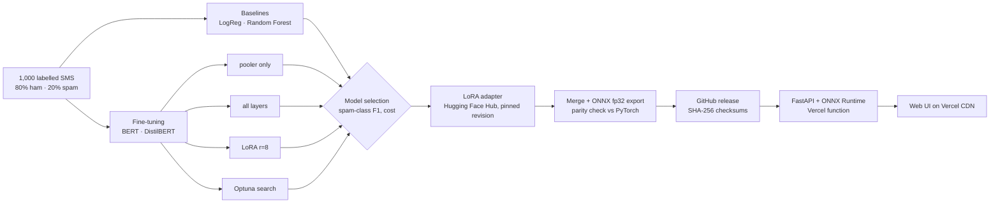
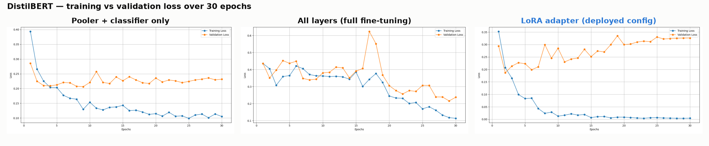
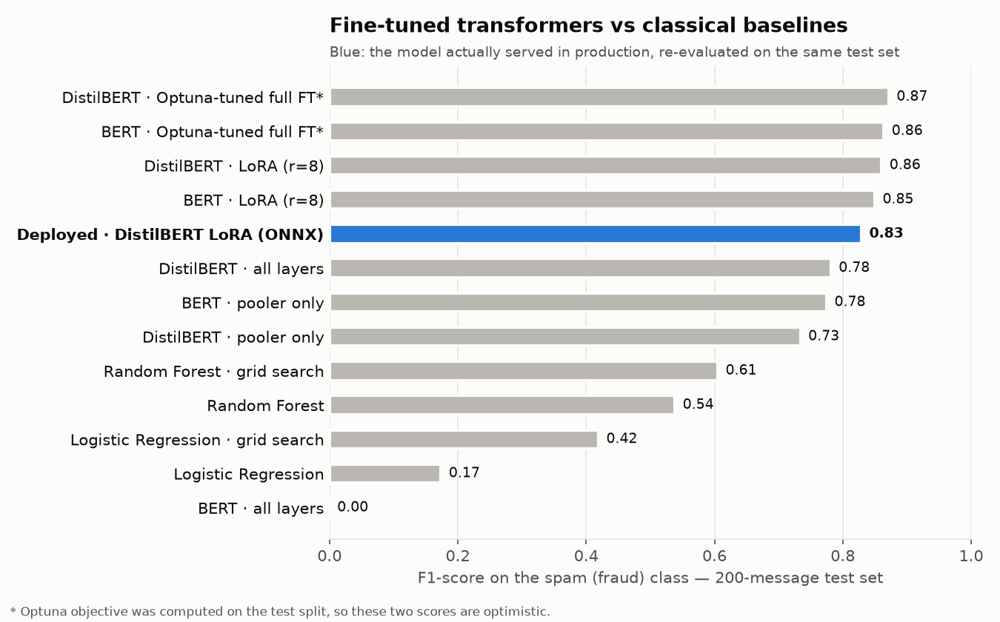
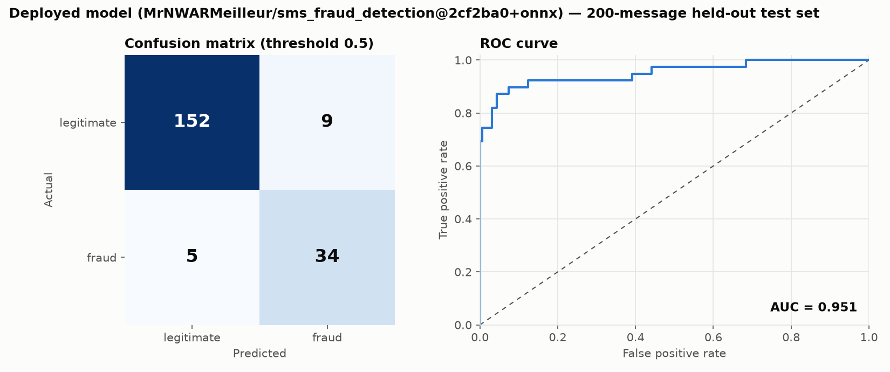

# SMS Fraud Detection

[](https://github.com/LandryJoelYvesSEBEOGO/Sms_fraud_detection/actions/workflows/ci.yml)

End-to-end machine learning project: from an imbalanced dataset of SMS messages to a fraud
detector running in production. Classical baselines and two transformers (BERT, DistilBERT) were
compared under three fine-tuning strategies. The selected model, DistilBERT with a LoRA adapter,
was published on the Hugging Face Hub, exported to ONNX and served through a FastAPI API and a
static web page on **Vercel**.


> **Status: proof of concept.** The model can be wrong in both directions. See
> [Model behaviour](#-model-behaviour) before relying on a verdict.

## 📋 Contents

- [The pipeline at a glance](#-the-pipeline-at-a-glance)
- [1. Data](#1-data)
- [2. Baselines](#2-baselines)
- [3. Fine-tuning the transformers](#3-fine-tuning-the-transformers)
- [4. Results and model selection](#4-results-and-model-selection)
- [5. From notebook to production](#5-from-notebook-to-production)
- [Model behaviour](#-model-behaviour)
- [Architecture](#-architecture)
- [API](#-api)
- [Deploy on Vercel](#-deploy-on-vercel)
- [Configuration](#️-configuration)
- [Local development](#-local-development)
- [Project structure](#-project-structure)
- [Quality and CI](#-quality-and-ci)

## 🧭 The pipeline at a glance



| Stage | Tools |
|---|---|
| Exploration, baselines | pandas, scikit-learn, TensorFlow `TextVectorization`, GridSearchCV |
| Fine-tuning | PyTorch, Hugging Face Transformers `Trainer`, PEFT (LoRA), Optuna |
| Packaging | PEFT `merge_and_unload`, `torch.onnx` export, GitHub Releases |
| Serving | FastAPI, ONNX Runtime, `tokenizers`, Vercel (Python function + CDN) |
| Quality | pytest, Playwright, ruff, GitHub Actions |

## 1. Data

The dataset holds **1,000 English SMS messages** from a mobile telephony context (operator
notifications, mobile-money receipts, promotions, personal messages), each labelled **ham**
(legitimate) or **spam** (fraudulent or scam).

- **Imbalanced**: 80.3% ham, 19.7% spam. Accuracy alone is therefore misleading: a model that
  never flags anything already scores 80%. Every comparison below uses the **F1-score of the spam
  class**.
- **Splits**: 800 messages for training (further split 80/20 into 640 train and 160 validation)
  and a **held-out test set of 200 messages** (161 ham, 39 spam), the same for every model.

## 2. Baselines

Two classical models set the bar the transformers must beat. Texts are lowercased and stripped
of punctuation and digits, then vectorised with TensorFlow's `TextVectorization`.

- **Logistic Regression** and **Random Forest**, both with `class_weight="balanced"`
  (cost-sensitive learning: errors on the minority class weigh more in the loss).
- A **grid search** (`GridSearchCV`, 3-fold cross-validation) over regularisation, solver, tree
  depth and number of trees.

The best baseline, a tuned Random Forest, reaches 85% accuracy but only **0.61 F1 on spam**: it
misses 4 frauds out of 10.

## 3. Fine-tuning the transformers

Two pre-trained encoders were fine-tuned for binary classification: **BERT-base** (110 M
parameters) and **DistilBERT** (66 M parameters, a distilled BERT that is about 40% smaller). Each
was trained with three strategies, so that the trade-off between adaptation and cost could be
measured:

| Strategy | What is trained | Trade-off |
|---|---|---|
| **Pooler only** | The classification head; the encoder stays frozen | Cheap and stable, but cannot adapt the language representation to fraud |
| **All layers** | Every weight of the network | Maximum flexibility, highest cost, unstable on 640 training examples |
| **LoRA** (low-rank adaptation) | Small rank-8 matrices added to the attention query and value projections, plus the classification head | Adapts the encoder while freezing 99% of its weights |

**How LoRA works.** Instead of updating a weight matrix `W` (d × k), LoRA freezes it and learns
a low-rank update `ΔW = B·A`, with `B` (d × r) and `A` (r × k). With `r = 8` and `d = k = 768`,
one projection needs 12,288 trainable values instead of 589,824. At inference time, `ΔW` is merged
back into `W`, so the model is exactly as fast as the original one.

Configuration of the run that was shipped:

| Setting | Value |
|---|---|
| Base model | `distilbert-base-uncased` |
| LoRA | `r=8`, `lora_alpha=16`, `lora_dropout=0.1`, targets `q_lin` and `v_lin` |
| Trainable parameters | ≈ 0.74 M (≈ 1.1% of the model): adapter file of **3 MB** |
| Optimisation | AdamW, learning rate `2e-4`, batch size 4, 30 epochs |
| Input | Truncated and padded to 134 tokens |

**Hyperparameter search.** Optuna (5 trials per model) explored the learning rate (1e-5 to
5e-4, log scale), batch size (4 to 16), number of epochs (10 to 30) and weight decay (0.01 to
0.3) for a full fine-tuning of each model.

### Training curves



- **Pooler only**: the validation loss settles at about 0.22 after a few epochs. The model
  learns quickly but plateaus, because the frozen encoder limits what it can capture.
- **All layers**: the loss is noisy, with a spike around epoch 17, before converging. On BERT the
  same strategy collapsed to predicting only "ham" (spam F1 of 0), a known failure mode of full
  fine-tuning on small, imbalanced data.
- **LoRA**: the training loss falls to almost zero while the validation loss reaches its
  minimum around epoch 2, then rises. The model memorises the 640 training messages: this is
  overfitting, and **early stopping on the validation loss** is the first improvement to make
  (see [Limitations](#limitations-and-next-steps)).

## 4. Results and model selection

All models are evaluated on the same 200-message test set.



| Model | Strategy | Accuracy | Spam precision | Spam recall | Spam F1 |
|---|---|---|---|---|---|
| Logistic Regression | class-weighted | 0.810 | 0.571 | 0.103 | 0.174 |
| Logistic Regression | + grid search | 0.820 | 0.565 | 0.333 | 0.419 |
| Random Forest | class-weighted | 0.820 | 0.538 | 0.538 | 0.538 |
| Random Forest | + grid search | 0.850 | 0.622 | 0.590 | 0.605 |
| BERT | pooler only | 0.910 | 0.756 | 0.795 | 0.775 |
| BERT | all layers | 0.805 | 0.000 | 0.000 | 0.000 |
| BERT | LoRA | 0.940 | 0.829 | 0.872 | 0.850 |
| BERT | Optuna, full fine-tuning\* | 0.945 | 0.833 | 0.897 | 0.864 |
| DistilBERT | pooler only | 0.895 | 0.725 | 0.744 | 0.734 |
| DistilBERT | all layers | 0.905 | 0.708 | 0.872 | 0.782 |
| **DistilBERT** | **LoRA** | **0.945** | **0.850** | **0.872** | **0.861** |
| DistilBERT | Optuna, full fine-tuning\* | 0.950 | 0.872 | 0.872 | 0.872 |

\* The Optuna objective was the loss on the test split, so these two scores are optimistic and
cannot be compared fairly with the others.

**Why DistilBERT + LoRA was shipped.**

1. **Best honest score.** It has the highest spam F1 among the runs whose test set played no
   part in training or tuning, and it catches 34 of the 39 frauds.
2. **Cheaper than BERT for the same quality.** BERT with LoRA scores slightly lower and took
   22.7 minutes to train, against 13.7 minutes for DistilBERT, which is also about 60% faster at
   inference.
3. **Built for deployment.** The 3 MB adapter is versioned on the Hugging Face Hub separately
   from the base model, and merges into it for inference, at no extra latency.

The transformers dominate the baselines: +0.25 spam F1 over the best Random Forest. Pre-trained
language understanding matters on short, informal texts where bag-of-words features are sparse.

### The deployed model, re-evaluated

The adapter published on the Hub ([`MrNWARMeilleur/sms_fraud_detection`](https://huggingface.co/MrNWARMeilleur/sms_fraud_detection),
revision `2cf2ba0`) comes from a separate training run with the same configuration. Its ONNX
export, the exact artifact served in production, was evaluated on the same test set:



| Accuracy | Spam precision | Spam recall | Spam F1 | ROC AUC |
|---|---|---|---|---|
| 0.930 | 0.791 | 0.872 | 0.829 | 0.951 |

Like the experiment run, it catches 34 of the 39 frauds, with 3 more false alarms (9 legitimate
messages flagged out of 161).

### Limitations and next steps

- **Small dataset.** With 39 spam messages in the test set, one message moves the recall by 2.6
  points. A larger test set, or cross-validation, would narrow the uncertainty.
- **Overfitting.** Training ran for a fixed 30 epochs and kept the last checkpoint. Early
  stopping on the validation loss (`load_best_model_at_end`) should improve generalisation.
- **Tuning on the test set.** A new hyperparameter search should optimise on the validation
  split only.
- **Domain shift.** The model only knows the style of its training data; see
  [Model behaviour](#-model-behaviour).

## 5. From notebook to production

Notebook artefacts are not production-ready: PyTorch and Transformers alone exceed Vercel's
500 MB function limit, and an unpinned model can change silently. The serving path was rebuilt
around three guarantees:

1. **Reproducible model.** The adapter revision is pinned (`2cf2ba0`): pushing a new version to
   the Hub cannot change what production serves.
2. **Faithful export.** The adapter is merged into the base model and exported to ONNX in full
   precision (fp32, no quantisation). The export is rejected if its probabilities differ from
   PyTorch by more than `1e-4`; the measured gap is `7.6e-7`.
3. **Verified delivery.** A GitHub Actions workflow publishes the ONNX model as a release with
   SHA-256 checksums. The API downloads it on cold start and verifies it before loading.

Serving needs neither PyTorch nor Transformers, only ONNX Runtime and `tokenizers`: about 190 MB
of dependencies. The rest of this README covers the serving side.

## 🔎 Model behaviour

Every export scores a small hand-labelled set of English messages and records the result in the
release's `metadata.json` (`sanity_report`). It is a smoke check of 12 messages, not an evaluation.

| Message (abridged) | Expected | Fraud score |
|---|---|---|
| You've won a $1000 gift card… reply with your PIN | fraud | 1.000 |
| FREE entry in 2 a wkly comp to win FA Cup final tkts… | fraud | 1.000 |
| Mom, I lost my phone… send me $200 for rent | fraud | 0.998 |
| URGENT: your bank account has been suspended… | fraud | 0.000 |
| Your package could not be delivered. Pay $1.99… | fraud | 0.000 |
| IRS notice: you owe back taxes… | fraud | 0.002 |
| Your Netflix payment failed. Update your card… | fraud | 0.000 |
| Hey, are we still on for lunch tomorrow at 12? | legitimate | 0.053 |
| Reminder: your dentist appointment is on Monday | legitimate | 0.000 |
| Your Uber is arriving in 3 minutes. | legitimate | 0.000 |
| Can you pick up milk on your way home? | legitimate | 0.996 |
| Happy birthday! Have a great day, see you tonight | legitimate | 1.000 |

The model agrees with 6 of the 12 labels, against 93% accuracy on its own test set. The gap is a
**domain shift**: the training data comes from an East-African mobile operator's traffic. Its
scams are mostly prizes, promotions, job and investment offers, while bank, parcel, tax and
subscription phishing are rare or absent. The model catches the scam styles it has seen and flags some ordinary personal
messages it has not. Its scores are almost always close to 0 or 1, so a score should not be read
as a calibrated probability. Extending the training data to these phishing styles is the main
lever to improve it.

## 🏗 Architecture

```
Vercel
├── CDN ─────────────── public/  (index.html, styles.css, i18n.js, app.js)
└── Python function ─── sms_fraud.main:app  (FastAPI)
        /v1/predict, /v1/predict/batch, /health, /ready, /docs
        └── ONNX Runtime + tokenizers
                └── model.onnx (fp32), downloaded on cold start to /tmp
                    from the GitHub release model-onnx-2cf2ba0, checksum verified
```

- **Model**: [`MrNWARMeilleur/sms_fraud_detection`](https://huggingface.co/MrNWARMeilleur/sms_fraud_detection),
  a LoRA adapter (r=8, `q_lin`/`v_lin`) on `distilbert-base-uncased`, revision `2cf2ba0` pinned.
- **Serving**: the adapter is merged into the base model and exported to ONNX in full precision.
  The weights are unchanged (no quantization), and the export is rejected if its probabilities
  differ from PyTorch by more than `1e-4` (measured gap on the real model: `7.6e-7`). Serving needs
  neither PyTorch nor transformers: ~190 MB of dependencies, well under Vercel's 500 MB limit.
- **Frontend and API share one origin**: no CORS configuration is needed.

## 📡 API

Interactive documentation: `/docs`.

| Method | Path | Description |
|---|---|---|
| `GET` | `/health` | Liveness probe |
| `GET` | `/ready` | Readiness probe (model loaded), returns the model version |
| `POST` | `/v1/predict` | Classify one message (1–2000 characters) |
| `POST` | `/v1/predict/batch` | Classify up to 32 messages |

```http
POST /v1/predict
Content-Type: application/json

{"message": "URGENT: your account is locked, verify at http://bit.ly/x"}
```

```json
{
  "label": "fraud",
  "is_fraud": true,
  "fraud_score": 0.982,
  "threshold": 0.5,
  "model_version": "MrNWARMeilleur/sms_fraud_detection@2cf2ba0+onnx",
  "latency_ms": 12.4
}
```

| Status | Meaning |
|---|---|
| `422` | Invalid input (empty, longer than 2000 characters, more than 32 messages) |
| `429` | Rate limit exceeded; see the `Retry-After` header |
| `503` | Model not loaded yet (cold start) |

Messages are never logged; only counts and latency are.

## 🚀 Deploy on Vercel

1. **Publish the ONNX model** (once per model revision): *Actions → Export ONNX model → Run
   workflow* on `main`. It exports the model, checks parity with PyTorch, smoke-tests the API and
   publishes the `model-onnx-2cf2ba0` release the API downloads. Releases are never overwritten.
2. **Import the repository** in Vercel (*Add New → Project*). The FastAPI preset is detected from
   `pyproject.toml` (`[tool.vercel] entrypoint = "sms_fraud.main:app"`). No build command and no
   environment variable are required.
3. **Deploy.** `public/` is served by the CDN, the API by a Python function (`vercel.json`:
   60 s max duration, tests/docs excluded from the bundle, security headers and CSP).
4. Every pull request gets a preview deployment. After each production deployment, the
   *Smoke test deployment* workflow checks the live site.

Recommended hardening:
- set `SMS_FRAUD_ONNX_SHA256` to the `model.onnx` checksum from the release's `metadata.json`;
- add a rate limiting rule in Vercel's firewall (the built-in limiter works per instance).

The first request after a period of inactivity starts a new instance, which downloads the model
(~270 MB). The page shows "Model warming up" and retries automatically during that time.

## ⚙️ Configuration

Environment variables, all optional:

| Variable | Default | Description |
|---|---|---|
| `SMS_FRAUD_BACKEND` | `onnx` | `onnx` (production) or `transformers` (PyTorch reference) |
| `SMS_FRAUD_ONNX_DIR` | `artifacts/onnx` (`/tmp/…` on Vercel) | Directory of the ONNX artifacts |
| `SMS_FRAUD_ONNX_URL` | `model-onnx-2cf2ba0` release | Where to download the artifacts when missing |
| `SMS_FRAUD_ONNX_SHA256` | — | Expected checksum of `model.onnx` |
| `SMS_FRAUD_THRESHOLD` | `0.5` | Minimum fraud score to flag a message |
| `SMS_FRAUD_MAX_TOKENS` | `512` | Truncation length |
| `SMS_FRAUD_RATE_LIMIT_PER_MINUTE` | `60` | Prediction requests per client per minute (`0` disables) |
| `SMS_FRAUD_TRUST_PROXY_HEADERS` | `true` on Vercel | Identify clients by `X-Real-IP` / `X-Forwarded-For` |
| `SMS_FRAUD_CORS_ORIGINS` | `[]` | Allowed origins, JSON list (empty = same origin only) |
| `SMS_FRAUD_DOCS_ENABLED` | `true` | Expose `/docs` and `/openapi.json` |
| `SMS_FRAUD_FRONTEND_DIR` | — | Serve the static frontend from the API (local development) |
| `SMS_FRAUD_LOG_LEVEL` | `INFO` | Log level |
| `SMS_FRAUD_BASE_MODEL`, `SMS_FRAUD_ADAPTER_REPO`, `SMS_FRAUD_ADAPTER_REVISION` | pinned | Model source (export and `transformers` backend) |

## 💻 Local development

```bash
python3.12 -m venv .venv && source .venv/bin/activate
pip install torch==2.5.1 --index-url https://download.pytorch.org/whl/cpu
pip install -r requirements-dev.txt
python -m playwright install chromium        # for the browser tests

python -m sms_fraud.export                   # export + parity check -> artifacts/onnx
SMS_FRAUD_FRONTEND_DIR=public python -m sms_fraud   # http://127.0.0.1:8080
python scripts/smoke_test.py                 # smoke test a running instance
```

Without the export step, the API downloads the published release on first start.

| File | Contents |
|---|---|
| `requirements.txt` (= `pyproject.toml` dependencies) | Runtime: ONNX Runtime, tokenizers, FastAPI |
| `requirements-ml.txt` | + PyTorch, transformers, PEFT: export and reference backend |
| `requirements-dev.txt` | + pytest, ruff, Playwright |

## 📁 Project structure

```
.
├── sms_fraud/               # API package
│   ├── main.py              # FastAPI app factory, routes, rate limiting hook
│   ├── schemas.py           # request/response models
│   ├── config.py            # environment-based settings
│   ├── onnx_predictor.py    # ONNX Runtime backend (production)
│   ├── predictor.py         # PyTorch reference backend
│   ├── artifacts.py         # download and checksum of ONNX artifacts
│   ├── export.py            # fp32 ONNX export, parity check, sanity report
│   └── ratelimit.py         # per-client rate limiter
├── public/                  # static frontend (served by Vercel's CDN)
├── tests/                   # pytest suite; tests/e2e: Playwright browser tests
├── scripts/smoke_test.py    # end-to-end check of a running instance
├── vercel.json              # function settings and security headers
├── .github/workflows/       # CI, ONNX export/release, deployment smoke test
└── docs/
    ├── AUDIT.md             # technical audit and roadmap
    └── images/              # training curves and evaluation figures
```

## ✅ Quality and CI

```bash
ruff check . && ruff format --check .
pytest -m "not e2e"     # unit and API tests, no network needed
pytest -m e2e           # browser tests under the production CSP
```

GitHub Actions runs lint, unit tests, browser tests, a runtime size guard (no torch, < 300 MB),
the ONNX export of the real model with its parity check on pull requests touching inference
code, and a smoke test of each production deployment.

## 📄 License

No license has been chosen yet.
